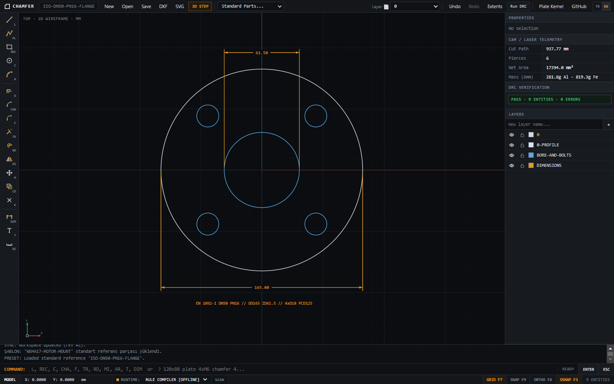
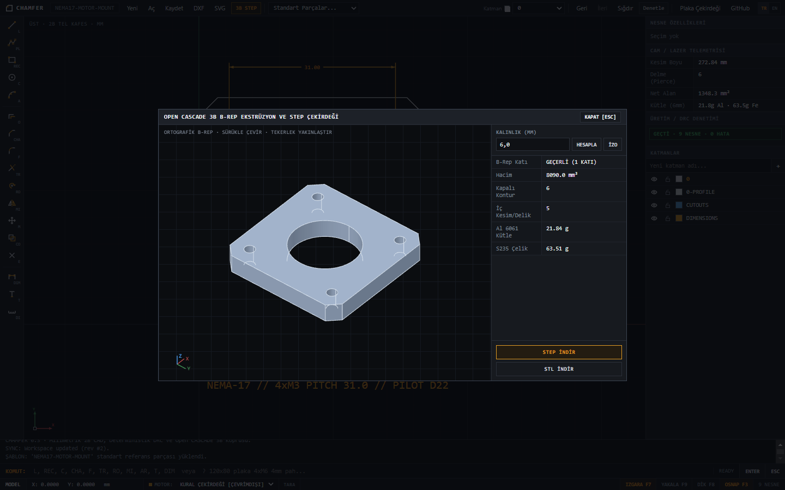

# Chamfer

An independent, open-source millimeter CAD workbench, deterministic geometry and specification
verifier, and 2D-to-3D solid manufacturing bridge started by Hasan Yahşi under **Aeonavis**.

Long-term direction: a local-first AutoCAD-class drafting and solid-modeling tool with exact
millimeter workflows, deterministic manufacturing verification, interoperable DXF/STEP files,
and commercial freedom without mandatory cloud subscriptions.

Implemented in `0.3.0a1`:
- **Zero-Install Browser Workbench & Local Python Bridge:** The static bundle in `web/dist`
  opens directly into the 2D millimeter CAD workbench at `/` (and `/?preset=fault`) on any
  standard static file host without requiring a backend: client-side R2010 millimeter ASCII DXF
  import/export (`LINE`, `LWPOLYLINE`, `CIRCLE`, `ARC`, `DIMENSION`, `TEXT` with non-plotting
  `CONSTRUCTION` layer preservation), manufacturing-DRC-stamped ISO `.svg` blueprint export,
  and interactive DRC repair preview (emerald ghost geometry + millimeter coordinate diffs).
  When `chamfer-serve` (`127.0.0.1:4310`) is running locally, live workspace sync, synthesis,
  and Open CASCADE 3D B-Rep extrusion activate automatically.
- **2D Millimeter Drafting Engine (Twin Python + JS Parity):** Command-driven planar CAD
  (`LINE`, `PLINE`, `RECTANG`, `CIRCLE`, `ARC`, `OFFSET`, `CHAMFER`, `FILLET`, `TRIM`,
  `ROTATE`, `MIRROR`, `ARRAY`, `DIM`, `TEXT`, `MOVE`, `COPY`, `ERASE`, `DIST`, `LINT`,
  `UNDO`, `REDO`, `LAYER` including `CONSTRUCTION` reference layers), instant `EN / TR`
  workstation toggle, AutoCAD-style object snaps (`END`, `MID`, `CEN`, `QUAD`, `INT`, `PER`),
  analytical window/crossing selection, and standard mechanical presets (`NEMA-17`, `ISO DN50`,
  `EIA 19" 1U`).
- **Analytical Topology & Manufacturing Verifier (`DRC`):** Order-independent planar
  `LINE + ARC` cycle chaining (`1e-4 mm` shared tolerance), analytical Green's theorem contour
  areas, curve-aware ray-casting interior predicates and exact quadratic/circle-circle curve
  intersections (including non-concentric `ARC-ARC` crossings and clearances — no polygon chord
  sampling), cross-layer collision checks, T-junction/self-intersection rejection, and explicit
  single-part manufacturing gates (`MULTIPLE_OUTER_PROFILES`, `NESTED_ISLAND_UNSUPPORTED`).
- **2D-to-3D Open CASCADE Solid Bridge (`STEP / STL`) & CAM Telemetry:** Extrudes verified
  single-part 2D profiles into Open CASCADE (`build123d`) 3D B-Rep solids, enforces positive
  manifold volume, top-face inner-wire topology, and 2D-vs-3D volume & surface-area invariants,
  renders an interactive orthographic 3D turntable preview, exports `.step` / `.stl`, and
  computes cut length, pierce count, scrap ratio, and Aluminum 6061 / Steel S235 mass.
- **Transactional Synthesis, Typed Feature Verification & MCP Server (`chamfer-mcp`):**
  Candidate-first validation on `/api/drawing/state` and `/api/drawing/exec` (rejected payloads
  never mutate active document or revision), bounded JSON nesting depth (`max_depth=64`),
  optimistic concurrency (`expected_revision` CAS + `request_id` idempotency), strict `stdio`
  MCP commit uncertainty reporting (post-connect transport drops raise explicit errors instead
  of silently falling back to an isolated local session), loopback discovery for local runtimes
  (`Ollama`, `LM Studio`, `llama.cpp`), and an offline parametric rule compiler verified against
  requested envelope, hole radii, obround slot capsules, flange `OD/ID/PCD` bolt circles, and
  corner chamfers/fillets before touching the active document.





## Quick start (local workbench)

Python 3.12 and Node.js 24 are required. On Windows PowerShell:

```powershell
python -m venv .venv
.\.venv\Scripts\python.exe -m pip install -r requirements.lock
.\.venv\Scripts\python.exe -m pip install --no-deps -e .
npm --prefix web ci
npm --prefix web run build
.\.venv\Scripts\chamfer-serve.exe --port 4310
```

Linux/macOS use `.venv/bin/python` and `.venv/bin/chamfer-serve`. Open
**http://127.0.0.1:4310** (or **http://127.0.0.1:4310/?preset=fault** to inspect a defective
CNC bracket, preview the proposed millimeter coordinate repairs on canvas, apply them, and
export verified DXF / STEP files). The static bundle in `web/dist` also runs all 2D drafting,
DRC preview-repair, CAM metrics, DXF import/export, and SVG blueprint export without a backend.

Standard engineering examples in `examples/`:
- [NEMA-17 stepper motor mount](examples/nema17-motor-mount.cadlab.json) (`42.3 × 42.3 mm`, `4×M3` on `31.0 mm` centers, `Ø22 mm` pilot bore, `3 mm` chamfered corners)
- [ISO DN50 PN16 pipe flange](examples/iso-dn50-flange.cadlab.json) (`Ø165 mm` OD, `Ø60.3 mm` bore, polar bolt circle)
- [EIA-310 19-inch 1U rack panel](examples/eia-1u-rack-panel.cadlab.json) (`482.6 × 44.45 mm` with slotted mounting ears)
- [Layered office layout](examples/office-layout.cadlab.json) (`CONSTRUCTION` and drafting layers on a `10 × 7 m` millimeter grid)

## Spatial verification suite & DRC benchmarks

Run the multi-gate spatial verification suite (`36` positive rule-compiler & DSL parts across 6
mechanical families checked for manufacturing DRC, Python↔JS parity, R2010 DXF round-trip,
raw-JSON feature compliance, and Open CASCADE `.step` serialization round-trip volume + 3D surface
area + bounding box; `15` curated adversarial & specification-tampering traps; and `6`
deterministic DRC preview-repairs). Note: default mode evaluates the offline deterministic rule
compiler (`parametric:chamfer-rule-v1`), not open-ended LLM spatial reasoning, and `.step`
re-import validates serialization consistency within Open CASCADE rather than a separate CAD
kernel; pass `--runtime <id>` to benchmark an external runtime:

```powershell
.\.venv\Scripts\python.exe benchmarks/spatial_eval.py
```

Run the 12-pair static DRC fault-recall and reference B-Rep fixture check, or lint any
`.cadlab.json` file from the CLI:

```powershell
.\.venv\Scripts\python.exe benchmarks/drc_benchmark.py
.\.venv\Scripts\chamfer.exe --lint-drawing examples/nema17-motor-mount.cadlab.json
```

## Programmatic CAD & MCP integration (`chamfer-mcp`)

`chamfer-mcp` runs over standard `stdio` JSON-RPC 2.0 (`2025-03-26` / `2024-11-05`):

```json
{
  "mcpServers": {
    "chamfer": {
      "command": "chamfer-mcp",
      "args": ["--port", "4310"]
    }
  }
}
```

Available MCP tools:
- `chamfer_get_drawing` — read active layers, entities, revision, and verification summary
- `chamfer_execute` — run atomic millimeter CAD command batches (`NEW`, `LAYER`, `RECTANG`, `PLINE`, `LINE`, `CIRCLE`, `ARC`, `OFFSET`, `CHAMFER`, `FILLET`, `TRIM`, `ROTATE`, `MIRROR`, `ARRAY`, `DIM`, `TEXT`, `SELECT`, `MOVE`, `COPY`, `ERASE`, `UNDO`, `REDO`)
- `chamfer_modify_entity` — surgically update entity coordinates, radii, layer, or closed loop state by ID (reporting explicit snap/closure deltas)
- `chamfer_lint` — run manufacturing or drafting DRC checks
- `chamfer_cam_report` — compute analytical net area, cut length, pierce count, scrap ratio, and part mass
- `chamfer_extrude_3d` — extrude verified single-part 2D profiles into Open CASCADE `.step` / `.stl` 3D solids (`overwrite=false` by default)
- `chamfer_export_dxf` / `chamfer_import_dxf` — verified ASCII R2010 millimeter DXF interchange

Local HTTP endpoints served by `chamfer-serve`: `/api/drawing/state` (supports `expected_revision`
CAS and `request_id` idempotency), `/api/drawing/exec`, `/api/drawing/lint`, `/api/drawing/dxf`,
`/api/drawing/import-dxf`, `/api/drawing/svg`, `/api/drawing/cam`, `/api/drawing/extrude`,
`/api/drawing/runtime`, and `/api/drawing/synthesize`.

## Automated checks

```powershell
.\.venv\Scripts\python.exe -m pytest -q
.\.venv\Scripts\python.exe -m ruff check src tests benchmarks
.\.venv\Scripts\python.exe -m ruff format --check src tests benchmarks
npm --prefix web test
npm --prefix web run format:check
npm --prefix web run build
```

## Explicit scope & current limits

Chamfer `0.3.0a1` targets **single-part planar XY 2D profiles extruded to single-thickness
prismatic 3D solids** (sheet-metal brackets, laser/waterjet plates, CNC mounts, pipe flanges,
and rack panels). Rather than silently approximating unsupported geometry, Chamfer rejects out-of-scope inputs explicitly:
- Disjoint multi-part sheets (`MULTIPLE_OUTER_PROFILES`) and nested islands inside cutouts (`NESTED_ISLAND_UNSUPPORTED`) are rejected in manufacturing DRC and 3D extrusion.
- DXF `LWPOLYLINE` bulge/widths, `SPLINE`, `ELLIPSE`, `BLOCK/INSERT`, paper-space entities, non-millimeter units, and rotated/projected `DIMENSION` subtypes whose measurement differs from aligned span are rejected cleanly without mutating the active drawing.
- Interactive geometric sketch constraint solving, multi-feature 3D history trees, assemblies, G-code post-processing, 3D sheet-metal bend unfolding, and proprietary DWG files are not implemented yet. Tracked items live on the [roadmap](docs/ROADMAP.md).

## Documentation

- [Roadmap](docs/ROADMAP.md)
- [Engineering decisions](docs/DECISIONS.md)
- [Verification notes](docs/REVIEW-RESULTS.md)
- [Third-party foundations](THIRD_PARTY.md)
- [Türkçe](README.tr.md)

## License

Original code is MIT-licensed. Dependencies retain their upstream licenses; in particular,
Open CASCADE is LGPL-2.1 with an additional exception.
