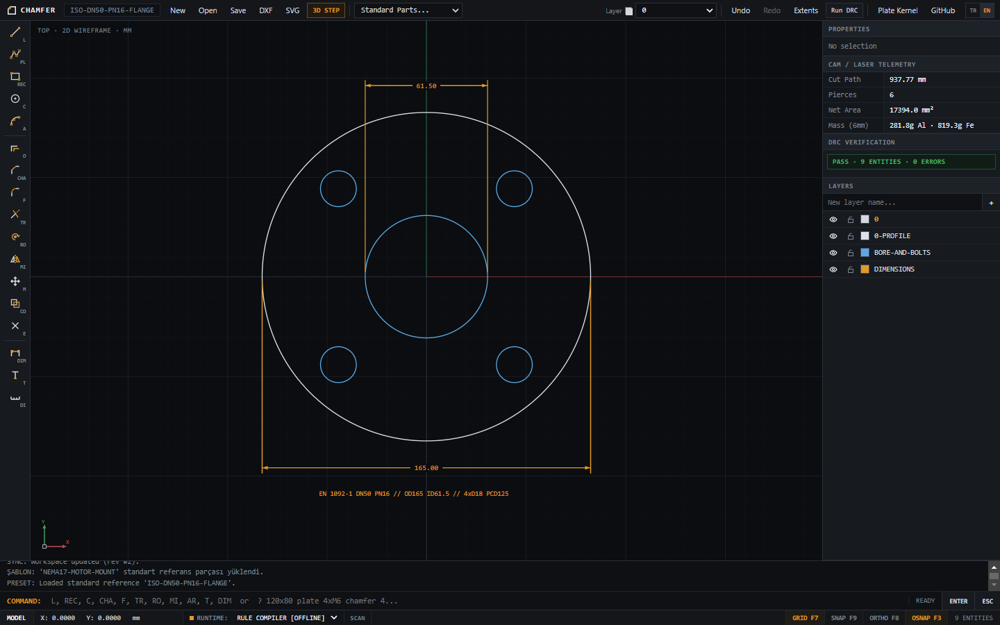
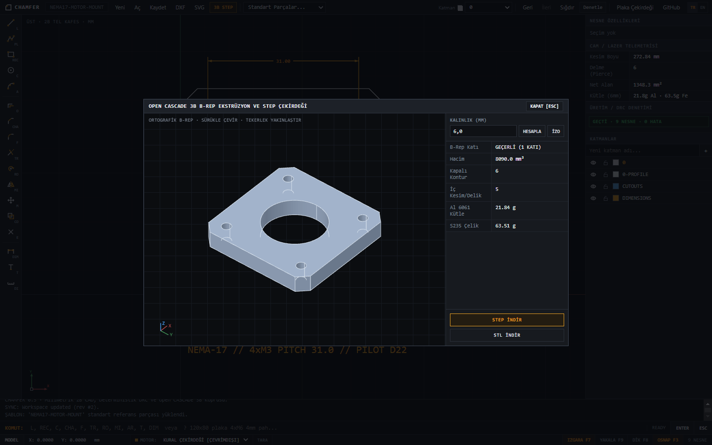

# Chamfer

[](https://github.com/hasanyahsitr/chamfer/actions/workflows/ci.yml) [](https://hasanyahsitr.github.io/chamfer/) [](LICENSE)

Hasan Yahşi tarafından **Aeonavis** çatısı altında geliştirilen bağımsız, açık kaynak
milimetrik CAD çalışma alanı, deterministik üretim/şartname doğrulayıcısı ve 2B-3B katı
model köprüsü.

Uzun vadeli hedef: hassas milimetrik koordinat akışı, deterministik kesim/üretim doğrulaması,
güvenilir DXF/STEP dosya alışverişi ve zorunlu bulut aboneliği gerektirmeyen ticari kullanım
sunan yerel öncelikli CAD uygulaması.

Kurulumsuz canlı tarayıcı çalışma alanı: **[2B CAD'i Aç](https://hasanyahsitr.github.io/chamfer/)** · **[Etkileşimli DRC Onarım Demosu (`?preset=fault`)](https://hasanyahsitr.github.io/chamfer/?preset=fault)**

`0.3.0a1` sürümünde çalışan yetenekler:
- **Kurulumsuz Tarayıcı Modu & Yerel Python Köprüsü:** Statik `web/dist` paketi herhangi bir
  statik dosya sunucusunda doğrudan `/` (ve `/?preset=fault`) kök adresinde 2B milimetrik CAD
  çalışma alanını açar: istemci tarafı R2010 mm ASCII DXF içe/dışa aktarma (`CONSTRUCTION`
  kesim dışı katmanların `plot=0` olarak korunması dahil), üretim DRC mühürlü ISO `.svg` pafta
  çıktısı ve yeşil kesikli koordinat farkı önizlemeli DRC onarım akışı. Yerelde `chamfer-serve`
  (`127.0.0.1:4310`) açık olduğunda canlı senkronizasyon, sentez ve Open CASCADE 3B STEP
  ekstrüzyonu otomatik devreye girer.
- **2B Milimetrik Çizim Motoru (Python ↔ JS İkiz Parite):** Komut satırı (`LINE`, `PLINE`,
  `RECTANG`, `CIRCLE`, `ARC`, `OFFSET`, `CHAMFER`, `FILLET`, `TRIM`, `ROTATE`, `MIRROR`,
  `ARRAY`, `DIM`, `TEXT`, `MOVE`, `COPY`, `ERASE`, `DIST`, `DENETLE`/`LINT`, `UNDO`, `REDO`,
  `LAYER` — kesim dışı `CONSTRUCTION` referans katmanları dahil), `TR / EN` arayüz dili geçişi,
  yakalama sembolleri (`END`, `MID`, `CEN`, `QUAD`, `INT`, `PER`) ve standart parça şablonları
  (`NEMA-17`, `ISO DN50`, `EIA 19" 1U`).
- **Analitik Topoloji ve Üretim Denetleyicisi (`DRC`):** Nesne sırasından bağımsız düzlemsel
  `LINE + ARC` halka zincirleme (`1e-4 mm` ortak tolerans), analitik Green teoremi alan hesabı,
  poligon örneklemesi kullanmayan analitik eğri kesişimleri (eşmerkezli olmayan `ARC-ARC`
  kesişim ve et kalınlığı kontrolleri dahil) ve eğri-duyarlı ışın (ray-casting) kapsama ağacı,
  üçlü kavşak (`T-branch`) / öz-kesişim reddi ve tek parça üretim kapısı
  (`MULTIPLE_OUTER_PROFILES`, `NESTED_ISLAND_UNSUPPORTED`).
- **2B -> 3B Open CASCADE Katı Model Köprüsü (`STEP / STL`) & CAM Telemetrisi:** Doğrulanmış
  tek parçalı 2B kesit profillerini Open CASCADE (`build123d`) 3B B-Rep katı modeline dönüştürür;
  pozitif katı hacmi, katı sayısını (`1`), üst yüzey iç tel (`inner_wires`) sayısını ve 2B–3B
  hacim + 3B yüzey alanı tutarlılığını zorunlu tutar; `.step` / `.stl` dışa aktarım ve kütle
  hesabı sunar.
- **Aday-Öncelikli Sentez, Unsur Doğrulaması & MCP Sunucusu (`chamfer-mcp`):** HTTP state/exec
  uçlarında aday doğrulaması tamamlanmadan aktif belge ve revizyon değiştirilmez; iç içe JSON
  derinlik sınırı (`max_depth=64`), `expected_revision` CAS (`HTTP 409`), `request_id`
  idempotency ve bağlantı kopmalarında belirsiz yazmayı sessizce yerel oturuma düşürmeyen
  `stdio` MCP köprüsü bulunur. Çevrimdışı kural derleyicisi ve yerel LLM çalışma zamanları,
  yalnız delik sayısını değil obround slot kapsül geometrisini, flanş `OD/ID/PCD` açısal
  dizilimini ve köşe pah/radyüs unsurlarını doğrular.





## Yerelde çalıştırma

Python 3.12 ve Node.js 24 ile Windows PowerShell:

```powershell
python -m venv .venv
.\.venv\Scripts\python.exe -m pip install -r requirements.lock
.\.venv\Scripts\python.exe -m pip install --no-deps -e .
npm --prefix web ci
npm --prefix web run build
.\.venv\Scripts\chamfer-serve.exe --port 4310
```

Tarayıcıda **http://127.0.0.1:4310** adresini (veya doğrudan hatalı CNC braketini inceleyip
önerilen koordinat onarımını tuval üstünde görmek için **http://127.0.0.1:4310/?preset=fault**
adresini) açın.

## Mekansal Doğrulama Paketi (`spatial_eval.py`) ve DRC Testleri

6 mekanik parça ailesinde `36` pozitif kural-derleyicisi & DSL görevini (atomik yürütme, üretim
DRC, Python↔JS paritesi, R2010 DXF round-trip, ham-JSON unsur doğrulaması ve Open CASCADE `.step`
serileştirme round-trip hacim + 3B yüzey alanı + zarf kontrolü), `15` seçilmiş yanıltıcı/şartname
tuzağını ve `6` deterministik DRC onarımını sınayan doğrulama paketi (varsayılan mod çevrimdışı
kural derleyicisini ölçer; harici LLM ölçümü için `--runtime <id>` verilebilir):

```powershell
.\.venv\Scripts\python.exe benchmarks/spatial_eval.py
.\.venv\Scripts\python.exe benchmarks/drc_benchmark.py
.\.venv\Scripts\chamfer.exe --lint-drawing examples/nema17-motor-mount.cadlab.json
```

## Açık kapsam ve sınırlar

Chamfer `0.3.0a1`, **düzlemsel XY tek-parça kesit profillerini sabit kalınlıkta prizmatik 3B katı
modele dönüştürme** iş akışına odaklanır. Desteklenmeyen topoloji veya varlıklar sessizce
yaklaşıklaştırılmaz, açık hata ile reddedilir:
- Çoklu ayrık dış profiller (`MULTIPLE_OUTER_PROFILES`) ve delik içi serbest adalar (`NESTED_ISLAND_UNSUPPORTED`) tek parça üretim modunda reddedilir.
- DXF `LWPOLYLINE` bulge/kalınlık, `SPLINE`, `BLOCK/INSERT`, kağıt uzayı ve ölçüsü hizalı uç mesafesinden sapan döndürülmüş/açısal `DIMENSION` alt türleri mevcut çizimi bozmadan reddedilir.
- Etkileşimli 2B kısıt çözücü, çok adımlı 3B unsur ağacı, montajlar, G-code üretimi, sac büküm açınımı ve tescilli DWG formatı henüz kapsam dışıdır ([yol haritası](docs/ROADMAP.md)).

## MCP entegrasyonu (`chamfer-mcp`)

Yeniden kullanılabilir milimetrik CAD çizim ve üretim doğrulama yeteneğini (`skills/chamfer/SKILL.md`; depo kuralları için [AGENTS.md](AGENTS.md)) tek komutla kurabilirsiniz:

```bash
npx skills add hasanyahsitr/chamfer
```

```json
{
  "mcpServers": {
    "chamfer": {
      "command": "chamfer-mcp",
      "args": ["--port", "4310"]
    }
  }
}
```

- [Yol haritası](docs/ROADMAP.md)
- [Teknik kararlar](docs/DECISIONS.md)
- [Doğrulama notları](docs/REVIEW-RESULTS.md)
- [Bağımlılık ve lisanslar](THIRD_PARTY.md)
